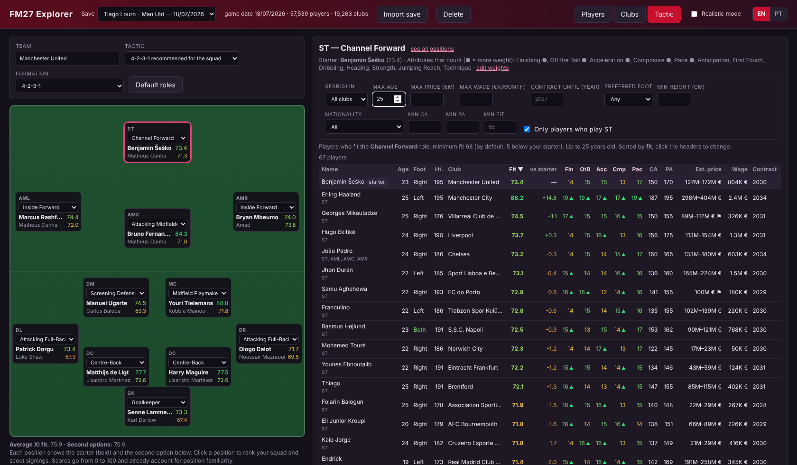
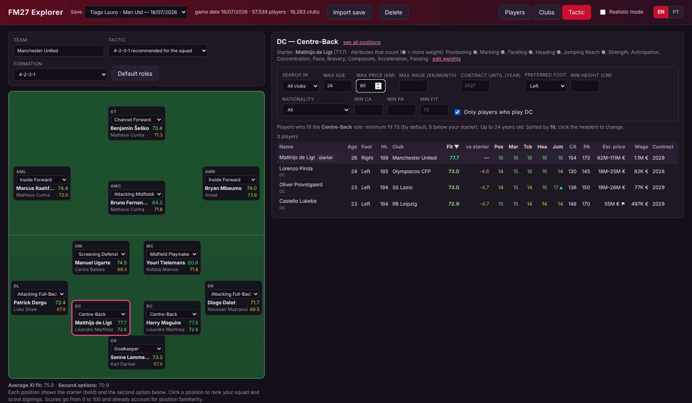

# FM27 Explorer

**Scout your Football Manager 2027 save with tactic-aware player search — entirely in the browser.**

FM27 Explorer reads a Football Manager 2027 save file (`.fm`), extracts every player and club,
and helps you answer the question the game makes hard to answer: *which players actually fit the
roles of my tactic, and who should I sign to improve each position?*

The save is processed locally in your browser. Nothing is uploaded.

> **Built on [fmsave](https://github.com/rhiever/fmsave)** by [Randal S. Olson](https://github.com/rhiever) —
> the open-source FM26/FM27 save reader that does the hard work of decoding the save format.
> FM27 Explorer would not exist without it. See [Acknowledgements](#acknowledgements).



## Features

- **Import any FM27 save** straight from the page (drag in a `.fm`). Multiple saves and seasons are
  kept side by side, so you can compare the same career across years.
- **Players and clubs database** — search 57k+ players by name, position, age, nationality, club and
  value, with every visible attribute plus the hidden ones (CA/PA, consistency, personality).
- **Tactic view**
  - Load the tactics you are using in-game (read from the save) or pick a built-in preset.
  - Choose the in-possession role for every position; the app computes the best XI and the
    second option for each slot, and flags weak positions.
  - Click a position to scout the whole database for players who fit **that role**, showing the
    role's key attributes side by side with your current starter.
  - Filter by max age, estimated price, wage, contract expiry, preferred foot, height, nationality,
    CA/PA; sort any column both ways.
- **Estimated asking price** and real **release clauses** from the save.
- **Realistic mode** hides CA/PA and hidden attributes for a fair-play experience.
- **English and Portuguese** interface (switch EN | PT in the top-right corner; English by default). Portuguese user guide: [docs/LEIA-ME.md](docs/LEIA-ME.md).



## Try it

- **Online:** open the GitHub Pages site for this repository and click *Importar save*.
- **Offline:** download this repository (Code → Download ZIP) and open **`FM27-Explorer.html`** in
  Chrome or Edge. That single file is the whole app.

FM27 saves live in `Documents\Sports Interactive\Football Manager 27\games`.
The first import needs an internet connection to download the in-browser Python runtime
(Pyodide) and the save reader (fmsave). After that, browsing works offline.

## How it works

```
 .fm save ──► Pyodide (Python in the browser) ──► fmsave ──► convert.py ──► compact JSON
                                                                           │
                                     IndexedDB (per save + in-game date) ◄─┘
                                                │
                       Players · Clubs · Tactic views (vanilla JS, no framework)
```

- **Save parsing** uses [fmsave](https://github.com/rhiever/fmsave), an open-source FM26/FM27 save
  reader, running inside [Pyodide](https://pyodide.org). `src/py/convert.py` turns its exports into a
  compact dataset (~20 MB for a full database).
- **Role fit** is a weighted average of each role's attributes, blended with the mean of its key
  attributes, scaled 0–100 and multiplied by the player's familiarity with the position. The best XI
  is solved as an assignment problem (Hungarian algorithm).
- **Price estimate** starts from the game's market value and adjusts for contract length, squad
  status and age, capped by any release clause.

More detail and the trade-offs behind each decision: [docs/ARCHITECTURE.md](docs/ARCHITECTURE.md).

## Development

Requirements: Python 3.10+ (build), optionally Node.js (JS syntax check in tests).

```bash
python tools/build.py          # rebuilds FM27-Explorer.html from src/
pip install pytest fmsave==0.12.6
pytest -q                      # includes a check that FM27-Explorer.html is up to date
```

Project layout:

```
src/index.html        page skeleton with include markers
src/css/styles.css
src/js/i18n.js        English/Portuguese strings and language switch
src/js/boot.js        storage + save import
src/js/app.js         players/clubs views, player card, sorting
src/js/tactic.js      formations, roles, fit scores, scouting
src/py/convert.py     runs in the browser (Pyodide): save → app data
tools/build.py        stitches everything into FM27-Explorer.html
FM27-Explorer.html    the built, ready-to-use app (committed)
tests/                build and converter tests
```

Pushing to `main` runs the tests and deploys the built page to GitHub Pages
(`.github/workflows/`).

## Limitations

- Fit scores and asking prices are the app's own models, not the game's internal values. Use the
  in-game role stars as the final word.
- `.fmf` tactic files are encrypted, so tactics are read from the save after you load them in-game.
  Formation and positions are available; role choices are not readable and must be picked in the app.
- fmsave officially verifies FM27 build 27.0.0; newer patches usually work but are flagged as
  unverified.

## Acknowledgements

- **[fmsave](https://github.com/rhiever/fmsave)** by **Randal S. Olson** (MIT) — reads Football Manager
  26/27 saves into Python records. Every player, club, contract, release clause and tactic shown in
  FM27 Explorer comes from fmsave's readers; this project only adds the browser packaging, the
  tactic/scouting models and the UI on top. If you find FM27 Explorer useful, please star fmsave and
  report save-format issues [upstream](https://github.com/rhiever/fmsave/issues).
- **[Pyodide](https://pyodide.org)** (MPL-2.0) — makes it possible to run fmsave inside the browser.
- The **FM-Arena** community, whose match-engine testing informed the attribute weights and the
  built-in tactic presets.

## Credits and disclaimer

Built by **Tiago Louro**, developed with AI pair-programming (Claude).
See [THIRD_PARTY_NOTICES.md](THIRD_PARTY_NOTICES.md) for licences.

Not affiliated with or endorsed by Sports Interactive or SEGA. Football Manager is a trademark of
Sports Interactive Limited.

Licensed under the [MIT License](LICENSE).
